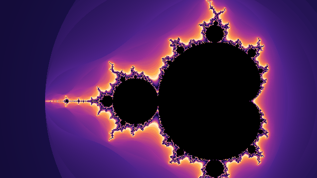
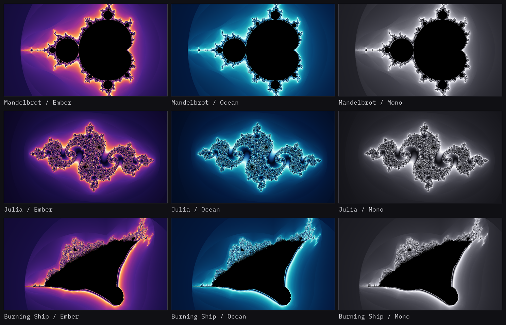

# FractalGeneration

[](https://github.com/McMorsh/FractalGeneration/actions/workflows/build.yml)
[](LICENSE)

**English** | [Русский](README.ru.md)

An interactive fractal visualizer written in C++20. The Mandelbrot, Julia, and
Burning Ship sets are computed in parallel with OpenMP and displayed in a raylib
window. It includes smooth coloring, zoom to the cursor, background frame
rendering, PNG export up to 8K, and zoom GIF animation.


## Features

- three fractals: Mandelbrot, Julia, and Burning Ship, switched with `T`;
- smooth coloring based on the continuous iteration count;
- three palettes: Ember, Ocean, and Mono;
- wheel zoom toward the point under the cursor, panning with the mouse and
  arrow keys;
- copying and pasting the view via the clipboard (`C` and `V`);
- automatic iteration count selection when zooming, plus manual adjustment;
- parallel computation with OpenMP and a background thread, so the UI stays
  responsive;
- GPU computation via OpenCL for all three fractals, with fallback to AVX2 and
  scalar code;
- backend selection with `--backend auto|cpu|opencl`; the active device is
  shown in the HUD;
- half-resolution preview while moving and a full frame after stopping;
- window resizing with frame recomputation;
- PNG export without the UI in FHD, 2K, 4K, or 8K;
- view bookmarks: `1`...`9` and `Shift + 1`...`9`;
- zoom export to GIF with `F3`: 1280x720, 25 fps, 5 seconds;
- Russian and English UI; the language choice is remembered;
- headless PNG rendering via the command line;
- recomputation only when the view changes, not on every frame.

Example of zooming toward the set boundary:



## Controls

| Action | Keys and mouse |
| --- | --- |
| Zoom in or out | Mouse wheel, `+` and `-` |
| Move the image | Arrow keys, left mouse button and drag |
| Copy or paste the view | `C` and `V` |
| Go to a bookmark | `1`...`9` |
| Save a bookmark | `Shift + 1`...`9` |
| Increase or decrease the iteration count | `[` and `]` |
| Switch the palette | `P` |
| Switch the fractal | `T` |
| Reset the view | `R` |
| Save a PNG at the selected resolution | `F2` |
| Export a zoom to GIF | `F3` |
| Select the PNG resolution | `Shift + left / right` |
| Hide or show the UI | `F11` |
| Fullscreen mode | `Alt + Enter` |
| Show or hide help | `H` |
| Switch the UI language | `L` |
| Exit | `Esc` |

The application version is shown in the lower right corner while the UI is
visible.

### Fractals

The `T` key cycles through Mandelbrot, Julia, and Burning Ship.

For Julia, the parameter `c` is controlled by two sliders in the `Julia c`
panel in the lower right: `Re` and `Im`, range -2 to 2. The default value is
`-0.8 + 0.156i`; the initial view is centered at zero with width 4, and the `R`
key returns to it.

Burning Ship has no parameter. The initial view is centered near `(-0.5, 0.5)`
with width 4.

The selected type and `c` persist between runs. Changing the type keeps the
current view, so `R` may be needed after switching. For Julia, when the window
width is below 800 px, the help panel is hidden so it does not overlap the
sliders.

## Gallery

Three fractals and three palettes:



Full-size images are in `docs/gallery/`.

### PNG export

`F2` renders the frame at the selected resolution in the background and saves
`<fractal>_YYYYMMDD_HHMMSS<suffix>.png`. Presets: FHD (1920x1080),
2K (2560x1440), 4K (3840x2160), and 8K (7680x4320); the file suffix is `_fhd`,
`_2k`, `_4k`, or `_8k`. The current preset is shown in the HUD as `PNG 4K` and
switched with `Shift + left / right`. The choice is remembered.

The frame preserves the window's vertical extent and expands horizontally to
16:9. The UI is not included in the PNG. At 8K, rendering takes noticeably
longer and requires more memory.

### GIF animation

`F3` starts a background export of a zoom toward the point under the cursor.
Settings: 1280x720, 25 fps, 5 seconds, and about 1000x magnification from the
current view. The file is named `zoom_YYYYMMDD_HHMMSS.gif` and saved to the
current directory.

The iteration count and color cycle length are fixed for the whole animation,
so the palette does not flicker. The frame preserves the window's vertical
extent and expands horizontally to 16:9, as with PNG export. If the cursor is
inside the set, the zoom will go into the black interior; point it at the
boundary or an interesting area. Pressing `F3` again cancels the export;
progress is shown in the HUD. At deep zoom, frames take longer to compute and
the file becomes larger.

### Clipboard

`C` copies the center, span, zoom, iteration count, and palette. `V` pastes
these parameters back; zoom is restored from the span. If the clipboard does
not contain suitable text or the parameters are incompatible, the view does
not change and an error message appears.

### Bookmarks

`Shift + 1`...`Shift + 9` open a name input field and save the current view to
the selected slot. `Enter` saves, `Esc` cancels. An empty name is replaced with
`Bookmark N`. The `1`...`9` keys restore a saved view; if the slot is empty, a
message about it appears in the HUD.

A bookmark stores the center, span, iteration count, palette, fractal type,
and Julia `c`, so the view is restored completely. The file is located next to
the settings:

- Windows: `%APPDATA%\FractalGeneration\bookmarks.txt`;
- Linux: `$XDG_CONFIG_HOME/FractalGeneration/bookmarks.txt` or
  `~/.config/FractalGeneration/bookmarks.txt`.

The format is plain text: a block starts with `[N] name`, followed by the view
fields. The file can be edited manually, and names can be changed there too.

### Iterations

`[` and `]` change the iteration count. The step grows with the value: about
100 at small values and several thousand at deep zoom. The range is 50 to
200,000. Hold the key to change the value continuously.

### Language and settings

`L` switches between the Russian and English UI. The window title, HUD, help
panel, and notifications update immediately.

Settings are stored in `settings.txt`:

- Windows: `%APPDATA%\FractalGeneration\settings.txt`;
- Linux: `$XDG_CONFIG_HOME/FractalGeneration/settings.txt` or
  `~/.config/FractalGeneration/settings.txt`.

It also stores the palette, PNG preset, fractal type, and Julia `c`. If the
file is deleted, the next launch will use Russian, Ember, FHD, and Mandelbrot
again. Settings from the old `MandelbrotFractalGeneration` directory are picked
up automatically.

Example file:

```text
language=ru
palette=Ember
fractal=julia
julia-re=-0.8
julia-im=0.156
png=4K
```

### Window resizing

The window can be resized by dragging its edge or corner; the minimum size is
640x480.
The fractal is recomputed for the new size while the center and scale are
preserved.

## Headless rendering

Without `--output`, the interactive window starts. With `--output`, the
application renders a PNG and exits immediately:

```bash
./build-mingw/FractalGeneration.exe \
  --output mandelbrot.png \
  --width 1920 --height 1080 \
  --iterations 800 \
  --center -0.743643887037151 0.131825904205330 \
  --span 0.001 \
  --palette Ocean
```

Julia example with a different `c` parameter:

```bash
./build-mingw/FractalGeneration.exe \
  --output julia.png \
  --fractal julia \
  --julia-re -0.4 --julia-im 0.6 \
  --span 4
```

| Option | Value |
| --- | --- |
| `-o, --output <file>` | PNG path, enables headless mode |
| `--width <px>` | image width, 1200 by default |
| `--height <px>` | image height, 800 by default |
| `--iterations <n>` | iteration count, selected from `--span` by default |
| `--center <re> <im>` | window center, `-0.6 0` by default |
| `--span <value>` | window width in complex units, 3.5 by default |
| `--palette <name>` | `Ember` (default), `Ocean`, or `Mono` |
| `--fractal <name>` | `mandelbrot`, `julia`, or `burningship`, `mandelbrot` by default |
| `--julia-re <value>` | real part of `c` for Julia, -0.8 by default |
| `--julia-im <value>` | imaginary part of `c` for Julia, 0.156 by default |
| `--backend <name>` | `auto`, `cpu`, or `opencl`, `auto` by default |
| `-v, --version` | show the application version |
| `-h, --help` | help |

Palette, fractal, and backend names are case-insensitive. The `--width`,
`--height`, `--iterations`, `--center`, `--span`, `--palette`, `--fractal`,
`--julia-re`, and `--julia-im` options only apply in headless mode. `--backend`
also applies in the window: the selected device is shown in the HUD. OpenCL
works for all three fractals; in headless mode, `--backend opencl` exits with
an error if no suitable GPU is available. In the GUI, Julia's `c` is controlled
by sliders, while headless mode uses `-0.8 + 0.156i` or the values from
`--julia-re` and `--julia-im`. For Burning Ship, use
`--center -0.5 0.5 --span 4`.

## How it works

For each point `c` on the complex plane, the following sequence is computed:

```text
z₀ = 0
zₙ₊₁ = zₙ² + c
```

Iterations continue while `|zₙ| ≤ 2`. Exceeding this limit means the point lies
outside the set, and the number of iterations before escape determines the
color.

For Mandelbrot, `z₀ = 0`, and the point on the plane is `c`. Julia is the
opposite: the point on the plane defines `z₀`, while `c` is constant and equal
to `-0.8 + 0.156i`, so different values of `c` produce different patterns.
For Burning Ship, `z₀ = 0` and the point on the plane defines `c`, but the
absolute values of the components are taken before each squaring:
`zₙ₊₁ = (|Re zₙ| + i |Im zₙ|)² + c`.

To remove bands between adjacent colors, a smooth estimate is used:

```text
μ = n + 1 - log₂(log₂ |zₙ|)
```

Points that do not escape within `max_iterations` steps are considered
interior and colored black.

### Palettes

| Palette | Colors | Purpose |
| --- | --- | --- |
| Ember | dark purple, crimson, orange, cream | warm accent on the boundary; the dark start of the cycle blends with the black interior |
| Ocean | dark blue, turquoise, white | cool alternative, better separates thin bands at deep zoom |
| Mono | grayscale | checking shape and smoothing without color influence |

All palettes are closed: the last color is close to the first, so there is no
visible seam when cycling. The cycle length grows with `max_iterations`;
otherwise bands become too dense at deep zoom. The palette is switched with
`P` and saved in the settings.

## Building

Requirements:

- a compiler with C++20 support;
- CMake 3.21 or newer;
- OpenMP;
- raylib 5.x or newer;
- giflib (for GIF animation);
- OpenCL (optional, for GPU computation);
- GoogleTest (for tests).

### Windows (MSYS2 / MinGW)

Install [MSYS2](https://www.msys2.org/) to `C:\msys64` and open the **MSYS2
UCRT64** terminal:

```bash
pacman -Syu
pacman -S --needed git mingw-w64-ucrt-x86_64-gcc \
  mingw-w64-ucrt-x86_64-cmake mingw-w64-ucrt-x86_64-ninja \
  mingw-w64-ucrt-x86_64-raylib mingw-w64-ucrt-x86_64-libgomp \
  mingw-w64-ucrt-x86_64-gtest mingw-w64-ucrt-x86_64-giflib \
  mingw-w64-ucrt-x86_64-opencl-headers mingw-w64-ucrt-x86_64-opencl-icd
```

Build:

```bash
git clone https://github.com/McMorsh/FractalGeneration.git
cd FractalGeneration

cmake --preset mingw-release
cmake --build --preset mingw-release
./build-mingw/FractalGeneration.exe
```

To run the exe from PowerShell or File Explorer, you do not need to change
PATH manually: when building with MinGW, CMake copies the required DLLs next
to the exe. The window icon `assets/icon.png`, font
`assets/IBMPlexMono-Regular.ttf`, and license `assets/OFL.txt` are copied to
`assets/` next to the exe, while `assets/icon.ico` is embedded into the file
itself.

The OpenCL backend is enabled automatically if CMake finds OpenCL. If the
packages are missing, the project builds with AVX2 and scalar CPU code.

### Linux

```bash
git clone https://github.com/McMorsh/FractalGeneration.git
cd FractalGeneration

# raylib dependencies for Debian and Ubuntu
sudo apt update
sudo apt install build-essential cmake git curl zip unzip tar pkg-config \
  libgl1-mesa-dev libx11-dev libxrandr-dev libxi-dev libxcursor-dev \
  libxinerama-dev libasound2-dev libwayland-dev libxkbcommon-dev wayland-protocols \
  libgif-dev ocl-icd-opencl-dev

git clone https://github.com/microsoft/vcpkg "$HOME/vcpkg"
"$HOME/vcpkg/bootstrap-vcpkg.sh"
"$HOME/vcpkg/vcpkg" install raylib gtest giflib

cmake -B build -S . -DCMAKE_BUILD_TYPE=Release \
  -DCMAKE_TOOLCHAIN_FILE="$HOME/vcpkg/scripts/buildsystems/vcpkg.cmake"
cmake --build build -j

./build/FractalGeneration
```

## Tests

```bash
cmake --preset mingw-release
cmake --build --preset mingw-release
ctest --preset mingw-release
```

On Linux, tests are run through the build directory:

```bash
ctest --test-dir build --output-on-failure
```

If tests are not needed, configure the project without `BUILD_TESTING` or pass
`-DBUILD_TESTING=OFF`.

## Project structure

| Path | Purpose |
| --- | --- |
| `fractal_core/fractal.hpp`, `fractal_core/fractal.cpp` | Computation of the selected fractal via OpenCL, AVX2, or scalar code |
| `fractal_core/backend.hpp`, `fractal_core/backend.cpp` | Selection and description of the compute backend |
| `fractal_core/fractal_opencl.hpp`, `fractal_core/fractal_opencl.cpp` | OpenCL backend for all fractals |
| `fractal_core/fractal_simd.hpp`, `fractal_core/fractal_simd.cpp` | AVX2 path for all fractals |
| `fractal_core/fractal_type.hpp`, `fractal_core/fractal_type.cpp` | Fractal type, Julia parameters, and name parsing |
| `fractal_core/view.hpp`, `fractal_core/view.cpp` | Camera: zoom, panning, and coordinates |
| `fractal_core/iterations.hpp`, `fractal_core/iterations.cpp` | Automatic iteration count and manual adjustment |
| `fractal_core/view_snapshot.hpp`, `fractal_core/view_snapshot.cpp` | View parameter format and parsing for the clipboard |
| `color_map/color_map.hpp`, `color_map/color_map.cpp` | Palettes and iteration-to-color conversion |
| `app/command_line.hpp`, `app/command_line.cpp` | Command line argument parsing and help |
| `app/headless.hpp`, `app/headless.cpp` | Headless PNG rendering |
| `app/application.hpp`, `app/application.cpp` | Main loop, input, preview, and export |
| `renderer/export_presets.hpp` | FHD, 2K, 4K, and 8K resolution presets |
| `renderer/fractal_render.hpp`, `renderer/fractal_render.cpp` | Window, texture, and on-screen UI |
| `renderer/image_render.hpp`, `renderer/image_render.cpp` | Headless rendering and PNG saving |
| `renderer/render_settings.hpp` | Shared frame settings for windowed and headless rendering |
| `renderer/image_export_worker.hpp`, `renderer/image_export_worker.cpp` | Background PNG export at the selected resolution |
| `renderer/gif_writer.hpp`, `renderer/gif_writer.cpp` | GIF89a writing with a shared palette |
| `renderer/animation_worker.hpp`, `renderer/animation_worker.cpp` | Background zoom animation export |
| `renderer/bookmarks.hpp`, `renderer/bookmarks.cpp` | View bookmarks and the `bookmarks.txt` file |
| `renderer/localization.hpp`, `renderer/localization.cpp` | Russian and English UI strings |
| `renderer/render_worker.hpp`, `renderer/render_worker.cpp` | Background frame rendering |
| `renderer/settings.hpp`, `renderer/settings.cpp` | Saving and loading UI settings |
| `main.cpp` | Entry point: mode parsing and application launch |
| `tests/` | GoogleTest tests for `CommandLine`, `Fractal`, `FractalType`, `Iterations`, `ColorMap`, `View`, `ViewSnapshot`, `ImageRender`, `ExportPresets`, `Localization`, and `Settings` |
| `assets/` | Icons, IBM Plex Mono font, and OFL license text |
| `docs/` | Images for the README |

## Future improvements

- other fractals, for example Tricorn;
- a cache of recent frames to return to a visited view;
- deeper zoom via perturbation theory;
- saving the selected backend in settings;
- Linux package as AppImage or Flatpak.

## License

The project is distributed under the [MIT](LICENSE) license.

IBM Plex Mono is distributed under the SIL Open Font License 1.1. The license
text is in `assets/OFL.txt`.
